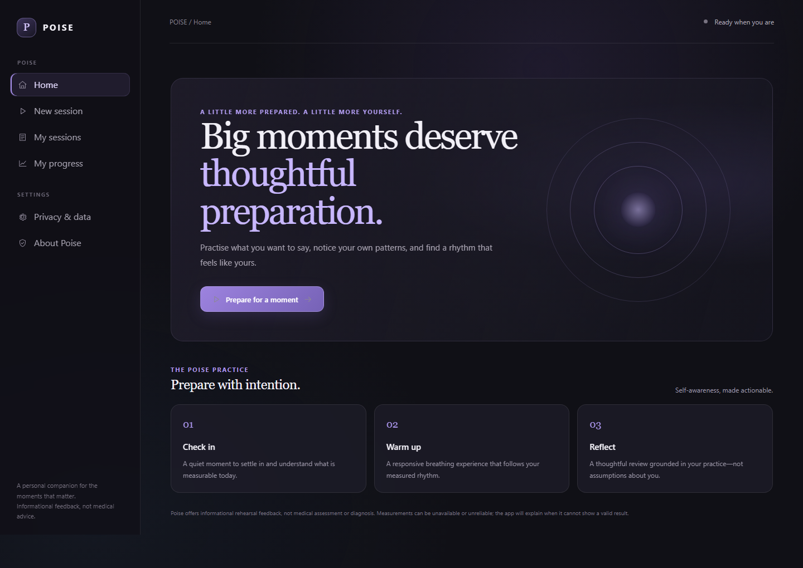
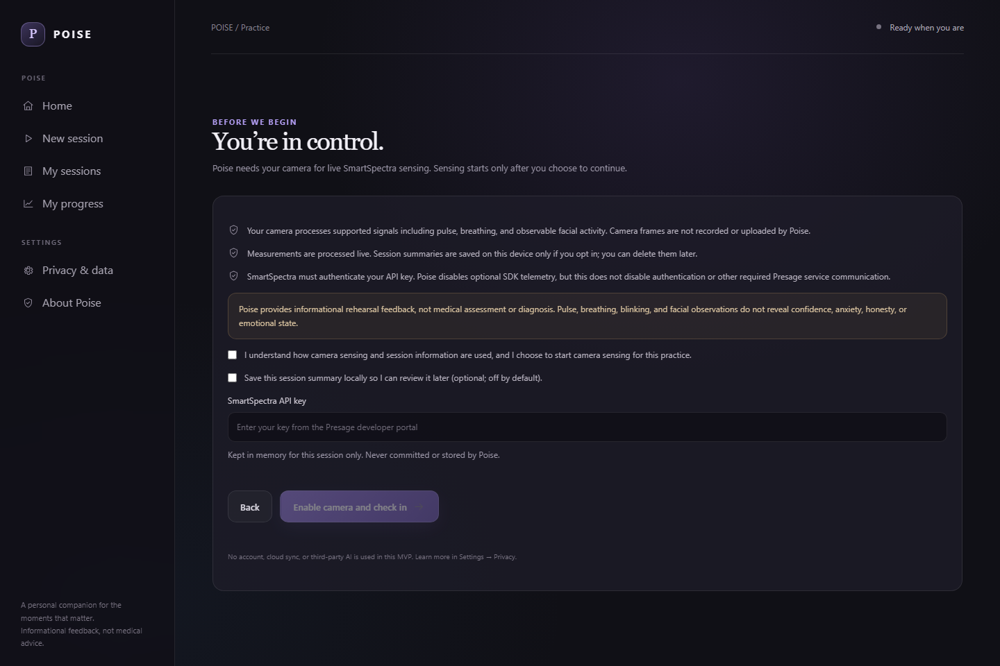

# Poise

**Show up as yourself. At your best.**

Poise is a Windows-first rehearsal companion for interviews, presentations,
pitches, and speaking on camera. It combines an optional camera-based
SmartSpectra check-in, a responsive warm-up, practical rehearsal, and a
reflection based only on supported measurements and observable practice.

Poise is informational rehearsal software, not a medical device or diagnostic
tool. It does not infer confidence, anxiety, honesty, or emotion.

## Screenshots

These are real application screens captured without a key, camera feed, or
simulated measurements.





## Product journey

- Choose a practice scenario, objective, and duration.
- Review camera and data disclosures; explicitly consent to sensing.
- Optionally save a session summary locally (off by default).
- See only stable, current SmartSpectra readings; missing signals remain
  unavailable, not zero.
- Use Observe warm-up for valid measured breathing or Guided warm-up for a
  separately labelled, user-selected target.
- Rehearse with a local interview prompt or a user-entered topic; Poise shows
  talking activity and intervals, not a transcript.
- Review a grounded reflection and, if opted in, local session history.

## Requirements

- Windows x64 and a supported webcam
- Node.js 22.12+ recommended (the Electron Builder toolchain requires it)
- A valid SmartSpectra API key and network access for SDK authentication and
  required Presage service communication

The SDK requires a key even though Poise disables optional SDK telemetry.
Telemetry opt-out does not make SDK authentication/service communication
offline.

## Run locally

```powershell
npm install
npm run dev
```

In the app, enter your API key in the password field when starting a session.
The key is needed by the official renderer SDK, held in memory during the
session, and not persisted or logged by Poise. Do not put it in a `VITE_*`
variable, source file, screenshot, or chat. `.env.example` contains no secret
and explains why runtime entry is used.

For Codex, install the official SmartSpectra skill from its source repository:

```text
$skill-installer Presage-Security/SmartSpectra/.agents/skills/using-smartspectra
```

The upstream skill is not vendored here because its repository does not declare
a redistribution license.

To create a production build or Windows package:

```powershell
npm run build
npm run dist:dir
npm run dist:win
```

The unpacked Windows app is created under `dist/win-unpacked`; the installer is
created under `dist/`. The package is currently unsigned and uses the default
Electron icon. Review the Windows publisher warning accordingly.

## Architecture and data

The renderer uses React/TypeScript and the official
`@smartspectra/node-sdk` Electron renderer integration. The Electron main and
preload processes bind the SDK's official IPC and expose a narrow, trusted
storage API. SQL.js stores opted-in session summaries in a SQLite file under
Electron `userData`. No account, cloud sync, automatic upload, or third-party
AI is included.

Camera frames are processed for live sensing and are not recorded or uploaded
by Poise. Raw face landmarks and high-frequency live measurements are not
persisted. The API key is not stored. See [docs/ARCHITECTURE.md](./docs/ARCHITECTURE.md),
[docs/PRIVACY.md](./docs/PRIVACY.md), and [docs/CONSENT.md](./docs/CONSENT.md).

## Tests and verification

```powershell
npm test
npm run test:e2e
npm run build
npm audit
npm run dist:dir
```

The current unit tests cover the session engine. Playwright covers onboarding,
scenario setup, consent, optional local saving, and privacy navigation; it
does not simulate SDK output. See [docs/TESTING.md](./docs/TESTING.md).

## Current limitation

The project builds, passes its current unit suite, has zero known npm audit
findings, and produces an unsigned Windows NSIS installer. The unpacked
Electron app launches and its SQLite storage bridge passes a
read/write/delete smoke test. The latest installer was installed to a
temporary location, launched, and uninstalled successfully. The first
live-sensing gate is **not yet verified**: a real user key, camera permission,
genuine SDK validation/metric events, and stop/release/restart behavior must
still be tested on a device. No synthetic data is shown as live. A three-minute
live demo and competition submission have not been produced; prepare these only
after the real-device gate passes.

## Project documents

- [Product vision](./docs/PRODUCT_VISION.md)
- [Architecture](./docs/ARCHITECTURE.md)
- [SmartSpectra integration and live gate](./docs/SMARTSPECTRA_INTEGRATION.md)
- [Privacy and data handling](./docs/PRIVACY.md)
- [Camera and data consent](./docs/CONSENT.md)
- [Testing and release verification](./docs/TESTING.md)
- [Three-minute demo script](./docs/DEMO_SCRIPT.md)
- [DEV submission draft](./docs/DEV_SUBMISSION_DRAFT.md)
- [Release checklist](./docs/RELEASE_CHECKLIST.md)
- [Codex build plan](./CODEX_BUILD_PLAN.md)

## Credits and licensing

Poise integrates Presage's SmartSpectra SDK. Consult the current SDK
documentation, terms, and included third-party notices for SDK and native
library licensing. This prototype does not yet include a separate license for
the Poise source.
